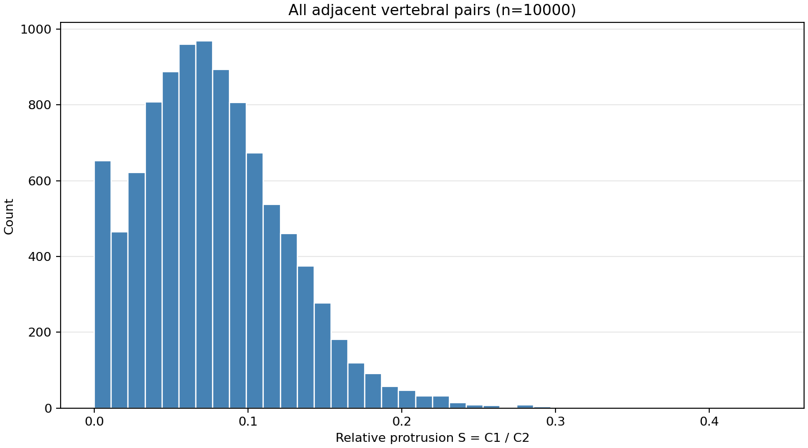
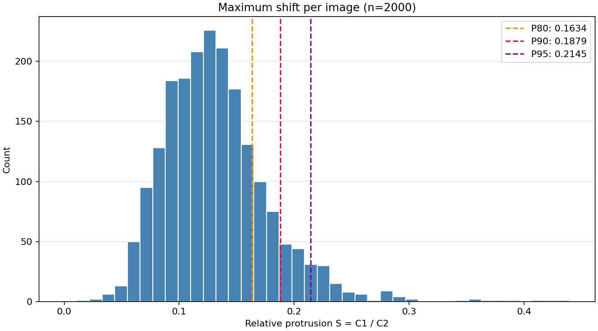
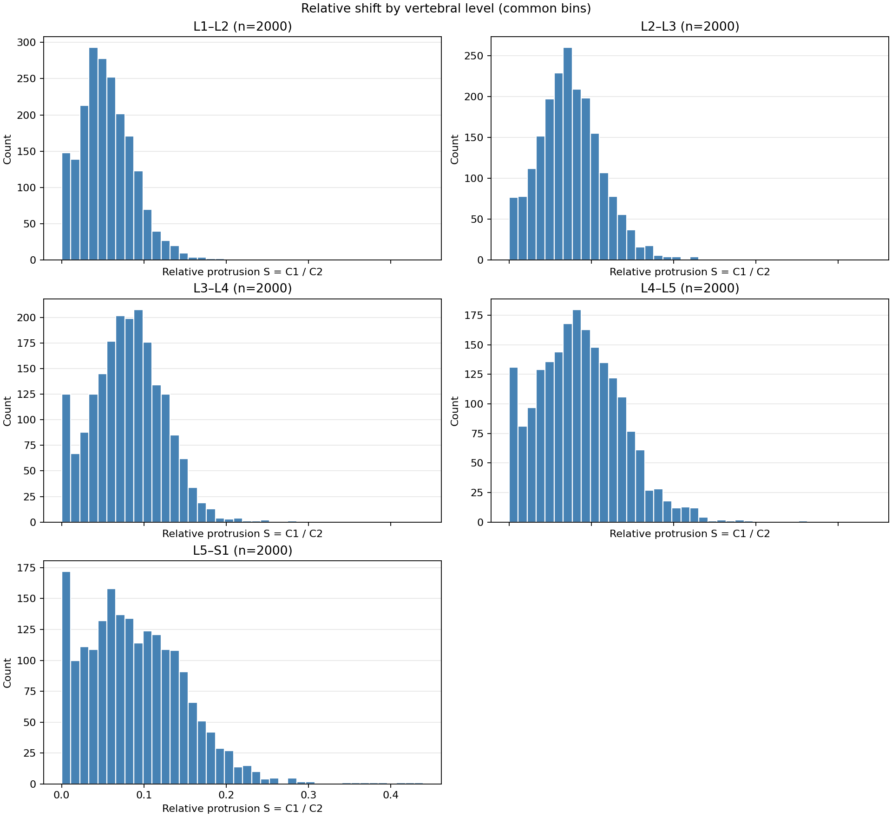

# Отчёт об относительном смещении соседних позвонков в BUU

Дата отчёта: 11 ноября 2026 года.

На всех 2000 боковых снимках BUU-2000 рассчитаны 10 000 значений
относительного выступания соседних пластин. Все измерения валидны.
Среднее значение по всем парам — 0,077636 (7,76% длины нижней пластины),
а среднее максимальное значение на снимок — 0,132101 (13,21%).
В этой выборке среднее значение и разброс увеличиваются от L1–L2 к L5–S1.

## 1. Состав выборки и полнота обработки

Анализ выполнен по исходным COCO-аннотациям `data/LumbarCoco2000/annotations`:

| Часть датасета | Снимков | Измерений соседних пар |
| --- | ---: | ---: |
| Train | 1600 | 8000 |
| Validation | 200 | 1000 |
| Test | 200 | 1000 |
| Всего | 2000 | 10 000 |

На снимке размечены 22 точки: по четыре точки для L1–L5 и две точки
верхней пластины S1. Рассмотрены пять пар: L1–L2, L2–L3, L3–L4,
L4–L5, L5–S1. В COCO одна аннотация на снимок; повторов и неоднозначных
аннотаций внутри выбранных файлов нет.

BUU-400 целиком входит в BUU-2000 по именам снимков. Разметка 12 общих
снимков различается между версиями, поэтому итоговые результаты получены
по полной версии BUU-2000 без смешивания версий. Все 2000 исходных
боковых снимков покрыты. AP-проекции в эту выборку с 22 точками не входят.
Использовались координаты до аугментаций.

| Показатель полноты | Количество |
| --- | ---: |
| Обработано уникальных снимков | 2000 |
| Валидных измерений | 10000 |
| Невалидных измерений | 0 |
| Снимков с валидным max_shift | 2000 |
| Снимков без валидных измерений | 0 |

## 2. Что именно измерено

Для каждой пары берутся нижняя пластина верхнего позвонка и верхняя
пластина нижнего позвонка. Их концы проецируются на единичную ось вдоль
верхней пластины нижнего позвонка. По упорядоченным проекциям вычисляются:

```text
C2 = lower_right - lower_left
C1 = max(0, lower_right - upper_right, upper_left - lower_left)
S = C1 / C2
```

`S = 0,10` означает, что наибольшее выступание нижнего интервала за верхний
составляет 10% длины нижней пластины. Учитываются обе стороны, но направление
выступания в итоговом числе не сохраняется. Если выступание есть с обеих
сторон, берётся большее из двух значений, а не их сумма.

`S = 0` означает, что нижний интервал полностью покрывается верхним;
равенство длин и совпадение центров для этого не обязательны.
При более короткой верхней пластине показатель может быть положительным
даже при совпадении центров. Например, для интервалов [2, 8] и [0, 10]
получится `S = 2 / 10 = 0,20`.

Величина безразмерна и устойчива к общему повороту, переносу и равномерному
масштабированию координат. В таблицах ниже значения приведены в долях,
если явно не указан знак процента.

Для снимка `max_shift` — максимальное валидное значение из пяти пар.

## 3. Общая статистика

| Выборка | Минимум | Максимум | Среднее | Медиана | Стандартное отклонение |
| --- | ---: | ---: | ---: | ---: | ---: |
| Все соседние пары | 0.000000 | 0.439911 | 0.077636 | 0.072764 | 0.047888 |
| Максимум на снимок | 0.019067 | 0.439911 | 0.132101 | 0.127029 | 0.046182 |

Для всех пар среднее выступание составляет 7,76%, медианное — 7,28%.
Для максимума на снимок среднее составляет 13,21%, медиана — 12,70%.
Стандартные отклонения соответствуют 4,79 и 4,62 процентного пункта.
Стандартное отклонение рассчитано с `ddof=0`.

Максимальное значение в выборке — 0,439911, то есть около 43,99%.
У каждого снимка хотя бы одна пара имеет положительное значение:
наименьший `max_shift` равен 0,019067. Это свойство выбранного показателя
и данной разметки; оно само по себе не означает наличие патологии на каждом снимке.

## 4. Процентили максимального смещения

| Процентиль | Порог в долях | Порог в процентах | Снимков строго выше | Доля снимков выше |
| --- | ---: | ---: | ---: | ---: |
| P50 | 0.127029 | 12.70% | 1000 | 50% |
| P75 | 0.155010 | 15.50% | 500 | 25% |
| P80 | 0.163400 | 16.34% | 400 | 20% |
| P90 | 0.187859 | 18.79% | 200 | 10% |
| P95 | 0.214475 | 21.45% | 100 | 5% |
| P99 | 0.279338 | 27.93% | 20 | 1% |

Процентили рассчитаны линейной интерполяцией. Число превышений рассчитано
по полным значениям порогов, до округления, со строгим условием `>`.

Например, 95-й процентиль равен 0,214475: у 100 снимков хотя бы одна пара
имеет значение выше этого порога, у остальных 1900 максимальное значение
его не превышает. Пороги описывают текущую выборку и могут служить для
отбора изображений на просмотр; они не являются диагностическими границами.

## 5. Статистика по уровням

| Пара | Валидных измерений | Минимум | Максимум | Среднее | Медиана | Стандартное отклонение |
| --- | ---: | ---: | ---: | ---: | ---: | ---: |
| L1–L2 | 2000 | 0.000000 | 0.210077 | 0.055375 | 0.052017 | 0.032496 |
| L2–L3 | 2000 | 0.000000 | 0.294485 | 0.074890 | 0.072778 | 0.038641 |
| L3–L4 | 2000 | 0.000000 | 0.280743 | 0.080910 | 0.080889 | 0.042798 |
| L4–L5 | 2000 | 0.000000 | 0.356077 | 0.086681 | 0.083129 | 0.050909 |
| L5–S1 | 2000 | 0.000000 | 0.439911 | 0.090324 | 0.083406 | 0.061134 |

Среднее увеличивается от 5,54% на L1–L2 до 9,03% на L5–S1:
разница составляет примерно 3,49 процентного пункта.
Одновременно стандартное отклонение увеличивается от 3,25 до 6,11
процентного пункта. Следовательно, на нижних уровнях наблюдается и большее
среднее значение, и более широкий разброс.

У L5–S1 самое большое среднее, наибольший разброс и общий максимум
выборки. Это не означает, что L5–S1 даёт максимальное значение на каждом
снимке: частота уровня, на котором достигается максимум, отдельно не подсчитывалась.

## 6. Интерпретация графиков

### 6.1. Все измерения — all_shifts_hist.png



По горизонтали показан показатель `S`, по вертикали — количество измерений
в интервале. Каждый снимок участвует пять раз, по числу соседних пар.
Основная масса значений визуально сосредоточена приблизительно в диапазоне
0–0,15. Распределение имеет правый хвост: большие значения встречаются
реже, но доходят примерно до 0,44. Среднее немного больше медианы,
что согласуется с этим хвостом.

Первый столбец объединяет нулевые и небольшие положительные значения.
Его высота не равна количеству строго нулевых измерений.

### 6.2. Максимум на снимок — max_shifts_hist.png



Каждый снимок представлен одним максимумом среди пяти пар. Основная часть
распределения находится правее, чем у всех измерений: выбор наибольшего
значения закономерно повышает показатель. Для каждого снимка максимум
не меньше любого из его пяти измерений.

Медиана 0,127029 означает, что у половины снимков все пять значений
не превышают приблизительно 12,70%, а у другой половины хотя бы одно
значение больше этого порога.

Пунктирные линии P80, P90 и P95 расположены на 0,163400, 0,187859
и 0,214475. Справа от них находятся соответственно 400, 200 и 100 снимков.
Эти группы вложены: снимки выше P95 входят также в группы выше P90 и P80.

### 6.3. Отдельные уровни — shifts_by_level.png



Каждая панель содержит 2000 измерений. На всех графиках используются
одинаковые 40 интервалов по оси X от нуля до общего максимума.
Шкалы количества по оси Y у панелей могут различаться, поэтому сравнивать
высоту столбцов следует по числовым отметкам оси.

L1–L2 имеет наиболее компактное распределение и самые низкие среднее
и медиану. По мере перехода к нижним уровням распределения в целом
смещаются к большим значениям и становятся шире. У L5–S1 наиболее
протяжённый правый хвост. Количественно это подтверждается таблицей
средних, медиан и стандартных отклонений.

## 7. Проверки качества и границы интерпретации

В ходе выполнения анализа проверены:

- 17 тестов геометрии и обработки COCO, включая выступание в обе стороны,
  разные длины при совпадающих центрах, поворот, нулевую длину,
  невидимые/невалидные точки и повторные аннотации.
- Совпадение 2000 уникальных строк CSV с полным набором исходных CSV BUU-2000/LA.
- Совпадение координат COCO с каждым исходным CSV.
- Правильность `max_shift` для каждой строки.
- Согласованность с независимым расчётом формулы: максимальное расхождение
  менее 2 × 10⁻¹⁵.
- Инвариантность всех 10 000 измерений к повороту на 73° с переносом:
  максимальное расхождение менее 6 × 10⁻¹⁵.
- Совпадение SHA-256 входных аннотаций до и после анализа.

Отсутствие невалидных измерений означает, что все использованные точки
прошли формальные проверки видимости, конечности, границ изображения
и ненулевой длины пластин. Это не является независимой оценкой точности
ручной разметки.

Показатель зависит одновременно от положения пластин, их относительной
длины и ориентации. Он не равен расстоянию между центрами, не показывает
направление смещения и не позволяет по одному числу разделить вклад
разницы размеров и взаимного сдвига.

Статистика описывает объединённую выборку train/val/test. Для дальнейшего
выбора параметров обучения или порогов модели следует рассчитывать их
на train либо train/val, сохраняя test для итоговой оценки.
Пять измерений одного снимка связаны между собой; 10 000 пар нельзя
автоматически считать 10 000 независимых наблюдений для статистических тестов.
Различия между уровнями здесь описательные: проверка статистической
значимости, анализ демографии и сопоставление с диагнозами не выполнялись.

## 8. Выводы и применение результатов

1. Полностью обработана доступная выборка из 2000 боковых снимков с нужной
   разметкой. Все 10 000 пар удалось измерить без пропусков и повторов.
2. Для отдельной пары типичное значение находится около 7–8% по среднему
   и медиане; для максимума на снимок — около 13%.
3. Средние значения и разброс последовательно увеличиваются от L1–L2
   к L5–S1. Поэтому при сравнении случаев полезно учитывать уровень пары,
   а не ограничиваться одним общим распределением.
4. Правый хвост позволяет выделить небольшую группу с высокими значениями:
   выше P95 находятся 100 снимков, выше P99 — 20. Их можно отобрать по
   `max_shift` из CSV и просмотреть вместе с исходными точками, чтобы
   понять вклад положения, размеров пластин и особенностей разметки.
5. Полученные распределения пригодны для описания геометрии датасета
   и формирования групп для проверки. Значения и процентили относятся
   именно к выбранному определению выступания; для клинической интерпретации
   или оценки анатомического сдвига нужна отдельная проверка соответствия метрики задаче.

## 9. Исходные результаты и воспроизводимость

- [Измерения для каждого снимка](vertebrae_shifts.csv).
- [Полная статистика, индексы точек и хеши источников](shift_statistics.json).
- [Инструкция повторного запуска и политика обработки ошибок](README.md).
- [Скрипт анализа](../../tools/analyze_vertebrae_shifts.py).
- [Тесты](../../tests/test_analyze_vertebrae_shifts.py).

Все числа в таблицах сформированы из `shift_statistics.json` и округлены
для чтения. Изображения, исходные аннотации и training pipeline не изменены.
