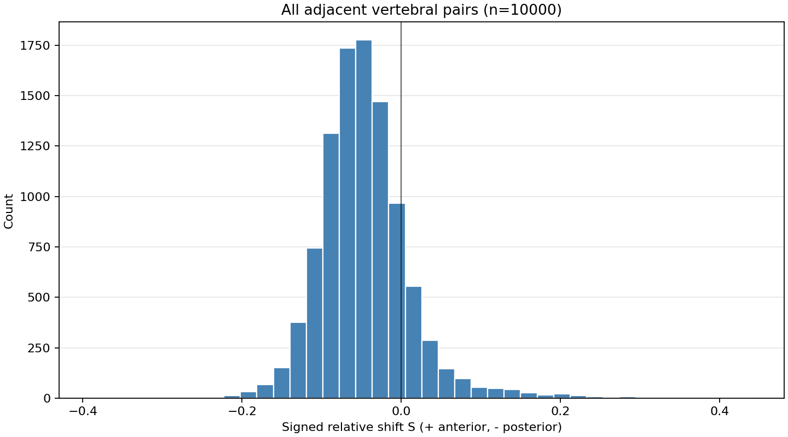
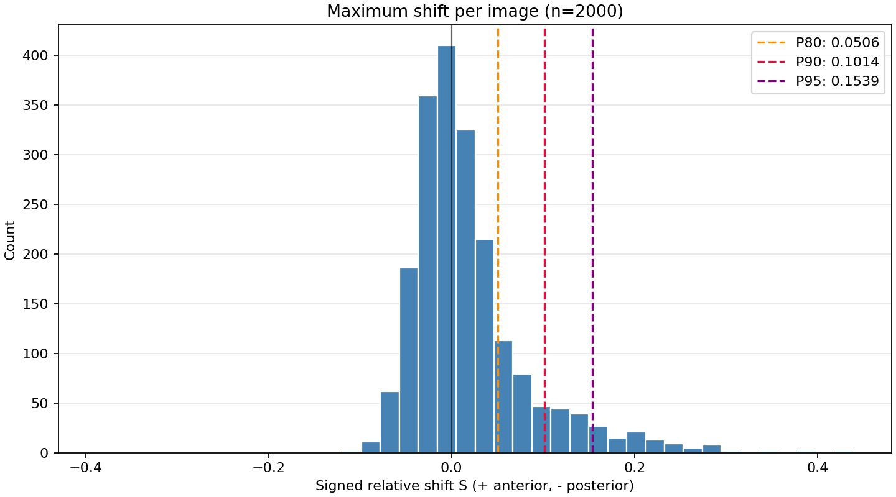
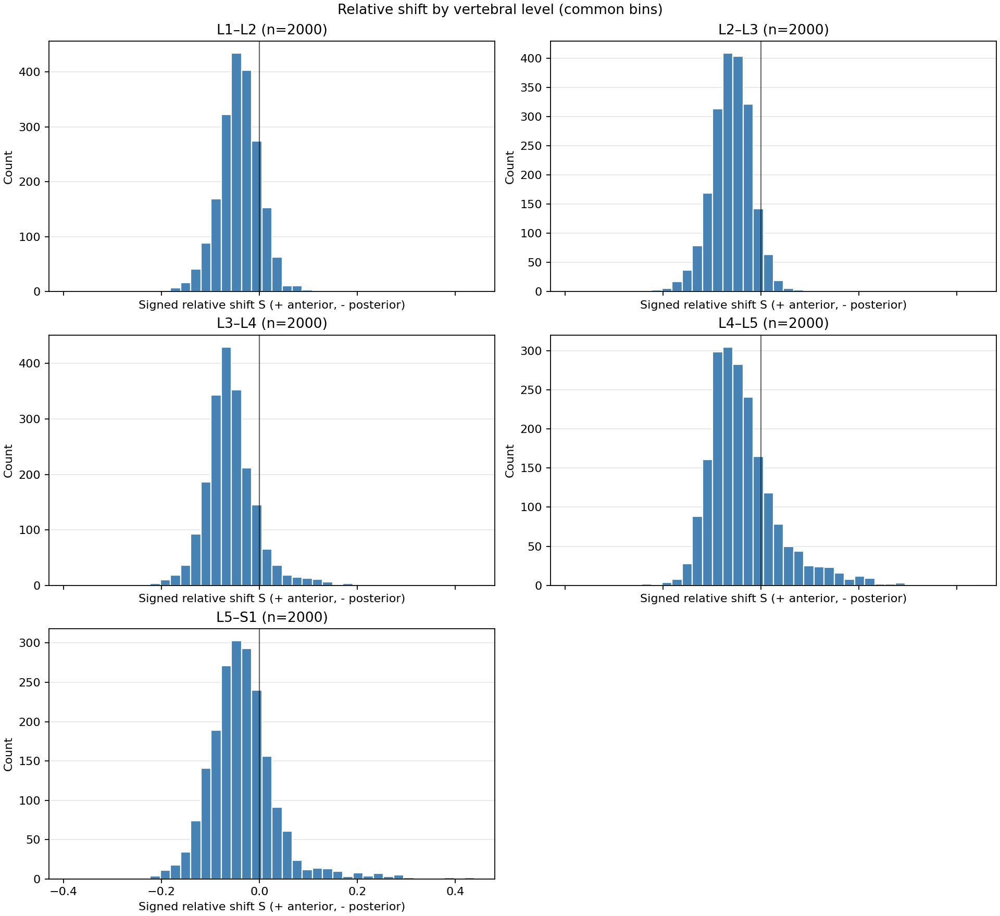

# Отчёт о знаковом смещении задних краёв соседних позвонков BUU

Дата перерасчёта: 15 ноября 2026 года. Версия определения метрики: 2.

На всех 2000 боковых снимках BUU-2000 рассчитаны 10 000 знаковых смещений
нижнего заднего угла верхнего позвонка относительно заднего края верхней
пластины нижнего позвонка. Среднее по всем парам равно -0.045941,
медиана — -0.050456. Отрицательных значений — 8484
(84,84%), положительных — 1516 (15,16%).
Все измерения прошли формальные проверки валидности.

## 1. Данные и полнота обработки

Источники — исходные COCO-аннотации `data/LumbarCoco2000/annotations`.
Координаты взяты до аугментаций. В каждом файле одна аннотация на снимок.

| Часть датасета | Снимков | Измерений |
| --- | ---: | ---: |
| Train | 1600 | 8000 |
| Validation | 200 | 1000 |
| Test | 200 | 1000 |
| Всего | 2000 | 10 000 |

На каждом снимке имеется 22 keypoints: L1–L5 по четыре точки и верхняя
пластина S1 из двух точек. Анализируются пары L1–L2, L2–L3, L3–L4,
L4–L5 и L5–S1.

BUU-400 полностью входит в BUU-2000 по именам снимков; разметка 12 общих
снимков различается между версиями. Для итогового анализа используется
полная версия BUU-2000 без повторного включения BUU-400. Покрыты все
2000 исходных LA-снимков. AP-проекции в эти 22-точечные COCO-аннотации не входят.

| Проверка полноты | Количество |
| --- | ---: |
| Уникальных обработанных снимков | 2000 |
| Валидных измерений | 10000 |
| Невалидных измерений | 0 |
| Снимков с валидным max_shift | 2000 |
| Снимков без валидных измерений | 0 |
| Повторных записей снимков в выбранных входных файлах | 0 |
| Снимков с несколькими различными аннотациями | 0 |

## 2. Геометрия и соглашение о знаке

Для каждой пары используются три анатомически определённые точки:

- `P` — нижняя задняя точка верхнего позвонка (`LnBB`).
- `A` — верхняя передняя точка нижнего позвонка (`LnTF`, для крестца `S1TF`).
- `B` — верхняя задняя точка нижнего позвонка (`LnTB`, для крестца `S1TB`).

Из `P` опускается перпендикуляр на прямую через `A` и `B`, основание — `Q`.
Смещение измеряется вдоль этой прямой от проекции `Q` к заднему краю `B`
и нормируется на длину верхней пластины нижнего позвонка:

```text
L = |B − A|
u = (B − A) / L
Q = A + dot(P − A, u) * u
S = dot(B − Q, u) / L = dot(B − P, u) / L
```

`S > 0`: задний нижний угол верхнего позвонка находится по проекции
перед задним краем нижнего. `S < 0`: находится позади него.
`S = 0`: задние края совпадают по проекции.
Например, при `A=(0,5)` и `B=(10,5)` точка `P=(7,0)` даёт `S=+0,30`,
а `P=(12,0)` даёт `S=−0,20`.

Проекция строится на бесконечную прямую; выход за пределы отрезка допускается.
Значения сохраняются со знаком, без модуля и ограничения диапазона.
Передняя точка верхнего позвонка в расчёте не участвует.

Порядок keypoints проверен по metainfo проекта и COCO-категориям.
Нулевые индексы `(P,A,B)`:

| Пара | Индексы |
| --- | --- |
| L1–L2 | (3, 4, 5) |
| L2–L3 | (7, 8, 9) |
| L3–L4 | (11, 12, 13) |
| L4–L5 | (15, 16, 17) |
| L5–S1 | (19, 20, 21) |

Ось задаётся анатомическим порядком «передний → задний», без сортировки
по координате X. Это сохраняет знак при повороте или зеркальном отражении.
Равномерное масштабирование и общий перенос также сохраняют отношение.

`max_shift` — обычный алгебраический максимум пяти валидных значений.
Он сохраняет знак: для пяти отрицательных значений результат отрицательный.
Например, для `[-0,30, -0,10, -0,05, -0,02, -0,01]` максимум равен `-0,01`.
Таким образом, `max_shift` отражает наибольшее значение в переднем направлении;
крупное отрицательное смещение может не определять этот максимум.

## 3. Общая статистика

Все значения в таблицах приведены в долях длины верхней пластины нижнего
позвонка, если явно не указан знак процента. `S=0,01` соответствует 1% длины.

| Выборка | Минимум | Максимум | Среднее | Медиана | Стандартное отклонение |
| --- | ---: | ---: | ---: | ---: | ---: |
| Все соседние пары | -0.388494 | 0.439911 | -0.045941 | -0.050456 | 0.058085 |
| max_shift | -0.112090 | 0.439911 | 0.019223 | 0.003368 | 0.066407 |

Среднее по всем парам — -4.59%, медиана — -5.05%.
Знак этих величин соответствует преобладанию заднего направления по выбранным
точкам. Среднее знаковых значений может частично компенсировать смещения
разных направлений и не равно средней величине их модулей.

У `max_shift` среднее равно 1.92%, медиана — 0.34%.
Отрицательный минимум `max_shift` (-0.112090) подтверждает наличие
снимков, на которых все пять пар имеют отрицательное значение.
Стандартное отклонение рассчитано с `ddof=0`.

## 4. Направления смещения

| Выборка | Отрицательных | Строго нулевых | Положительных |
| --- | ---: | ---: | ---: |
| Все пары | 8484 (84.84%) | 0 | 1516 (15.16%) |
| L1–L2 | 1709 (85.45%) | 0 | 291 (14.55%) |
| L2–L3 | 1884 (94.20%) | 0 | 116 (5.80%) |
| L3–L4 | 1804 (90.20%) | 0 | 196 (9.80%) |
| L4–L5 | 1552 (77.60%) | 0 | 448 (22.40%) |
| L5–S1 | 1535 (76.75%) | 0 | 465 (23.25%) |
| max_shift | 946 (47.30%) | 0 | 1054 (52.70%) |

У 946 снимков (47,30%) все пять значений отрицательны.
У 1054 снимков (52,70%) хотя бы одно значение положительно.
Строго нулевых значений нет; округлённое до нуля число или попадание
в столбец гистограммы около нуля не означает точного совпадения проекций.

## 5. Процентили max_shift

| Процентиль | Порог в долях | Порог в процентах | Снимков строго выше | Доля снимков выше |
| --- | ---: | ---: | ---: | ---: |
| P50 | 0.003368 | 0.34% | 1000 | 50% |
| P75 | 0.037760 | 3.78% | 500 | 25% |
| P80 | 0.050611 | 5.06% | 400 | 20% |
| P90 | 0.101369 | 10.14% | 200 | 10% |
| P95 | 0.153915 | 15.39% | 100 | 5% |
| P99 | 0.263534 | 26.35% | 20 | 1% |

Использованы линейная интерполяция и строгое сравнение `>` по полному
значению порога до округления. P95=0,153915 означает, что у 100 снимков
хотя бы одна пара имеет положительное смещение более 15,39%.
Группы выше P95, P90 и P80 вложены друг в друга.
Эти пороги характеризуют верхний хвост знаковой метрики; они не выделяют
снимки с наибольшими отрицательными смещениями.

## 6. Статистика по уровням

| Пара | Валидных | Минимум | Максимум | Среднее | Медиана | Стандартное отклонение |
| --- | ---: | ---: | ---: | ---: | ---: | ---: |
| L1–L2 | 2000 | -0.221038 | 0.135732 | -0.040635 | -0.039809 | 0.040624 |
| L2–L3 | 2000 | -0.304617 | 0.181987 | -0.060161 | -0.058976 | 0.041788 |
| L3–L4 | 2000 | -0.257816 | 0.202141 | -0.058658 | -0.063145 | 0.050518 |
| L4–L5 | 2000 | -0.231436 | 0.356077 | -0.036672 | -0.050185 | 0.071079 |
| L5–S1 | 2000 | -0.388494 | 0.439911 | -0.033578 | -0.039268 | 0.072373 |

Средние и медианы отрицательны на всех пяти уровнях. Наиболее отрицательное
среднее у L2–L3 (−6,02%), наиболее отрицательная медиана у L3–L4 (−6,31%).
Средние не изменяются монотонно от L1–L2 к L5–S1.

Разброс последовательно увеличивается к нижним уровням: стандартное
отклонение составляет 4,06 процентного пункта у L1–L2 и 7,24 у L5–S1.
У L4–L5 и L5–S1 чаще встречаются положительные значения (22,40% и 23,25%),
чем у L1–L2, L2–L3 и L3–L4. L5–S1 имеет самые крайние значения обоих
знаков во всей выборке: −0,388494 и +0,439911.
Это описательные наблюдения по текущей разметке.

## 7. Интерпретация графиков

### Все пары — all_shifts_hist.png



Ось X — знаковое относительное смещение, ось Y — число измерений в интервале.
Каждый снимок даёт пять значений. Чёрная вертикальная линия отмечает ноль:
слева от неё — заднее направление, справа — переднее.

Большинство измерений лежит в отрицательной области, что согласуется
с долей 84,84% и медианой около −0,05. Значения покрывают диапазон
примерно от −0,39 до +0,44. Положительный хвост растянут дальше от нуля,
чем отрицательный, хотя положительных измерений существенно меньше.

### Максимум на снимок — max_shifts_hist.png



Здесь каждый снимок представлен одним алгебраическим максимумом.
Выбор максимума смещает распределение вправо по сравнению со всеми парами;
при этом 946 максимумов остаются отрицательными. Медиана находится
около нуля (+0,003368), а среднее выше (+0,019223).

Пунктирные линии P80, P90 и P95 находятся на 0,050611, 0,101369 и 0,153915.
Правее них расположены соответственно 400, 200 и 100 снимков.
График описывает преимущественно отбор по переднему направлению;
для анализа выраженного заднего смещения нужно отдельно рассматривать
отрицательный хвост исходных пар или минимум на снимок.

### Уровни — shifts_by_level.png



Каждая панель содержит 2000 измерений. Во всех трёх файлах графиков
используются общие 40 интервалов от общего минимума до общего максимума;
отрицательные значения входят в гистограммы полностью. Вертикальная линия
нуля помогает сравнивать направления.

Распределения L2–L3 и L3–L4 имеют более отрицательные медианы,
чем остальные уровни. L4–L5 и L5–S1 характеризуются более широкими
распределениями и более длинными положительными хвостами.
Шкалы количества по оси Y у панелей могут различаться: сравнивать
высоты столбцов следует по числовым отметкам оси.

## 8. Проверка корректности

- Все 21 тест геометрии и обработки COCO прошли. Проверены оба знака,
  совпадение проекций, наклонная пластина, проекция вне отрезка, нулевая
  длина, поворот, отражение, масштабирование, отрицательный `max_shift`,
  невалидные точки, отсутствие зависимости от передней точки верхнего
  позвонка и повторные аннотации. Отдельно проверено, что интервалы
  гистограмм включают все отрицательные значения.
- 2000 уникальных строк CSV соответствуют всему набору исходных CSV BUU-2000/LA.
- Координаты каждой COCO-аннотации совпали с соответствующим исходным CSV.
- Для всех 10 000 измерений независимо построена проекция `Q`;
  максимальная разница с формулой скрипта — 9.30e-16.
- Проверена перпендикулярность `P−Q` и `B−A`: максимальный нормированный
  скалярный остаток — 9.16e-16.
- Поворот всех пар на 73° с переносом изменяет значения не более чем
  на 6.98e-15.
- Для каждой строки проверен знаковый максимум; сводная статистика,
  процентили, числа превышений и счётчики знаков сверены с CSV.
- Гистограммные интервалы включили все 10 000 измерений.
- SHA-256 исходных аннотаций совпали с хешами предыдущего запуска.

Для расчёта требуются три видимые точки COCO (`v=2`). Отсутствующие,
невидимые (`v=1`), неразмеченные (`v=0`), нечисловые/нефинитные точки,
выход за границы исходного снимка и нулевая длина `AB` дают `NaN`.
Причины сохраняются в JSON. Проверяются только точки, участвующие
в формуле: состояние передней точки верхнего позвонка на расчёт не влияет.
Отсутствие формальных ошибок не оценивает точность ручной разметки.

## 9. Выводы и использование

1. Полностью пересчитаны 2000 снимков и 10 000 пар по проекции задней точки;
   невалидных измерений нет.
2. На уровне отдельных пар преобладают отрицательные значения (84,84%).
   Типичное значение по медиане составляет около −5,05% длины верхней
   пластины нижнего позвонка.
3. Среднее знаковое смещение не растёт последовательно к нижним уровням,
   однако разброс увеличивается. У L4–L5 и L5–S1 больше положительных
   измерений и более выраженный положительный хвост.
4. У 47,30% снимков все пять значений отрицательны. Алгебраический
   `max_shift` сохраняет эти случаи со знаком, но не отражает наибольшее
   смещение по модулю. Для отбора крайних случаев в обоих направлениях
   следует просматривать оба хвоста исходных пяти измерений.
5. Порог P95=0,153915 выделяет 100 снимков с высокими положительными
   значениями. Сопоставление этих снимков и наиболее отрицательных
   измерений с исходной разметкой поможет оценить характер крайних случаев.

Метрика описывает взаимное положение задних краёв в локальной оси.
Она сохраняет направление, но различия формы и размеров позвонков
также могут влиять на положение этих краёв. Клинические классы и
статистическая значимость различий между уровнями в этом анализе
не оценивались. Пять измерений одного снимка зависимы друг от друга.

Объединение train/val/test используется для описания всего датасета.
При выборе параметров обучения или порогов модели следует опираться
на train либо train/val и сохранять test для итоговой оценки.

## 10. Файлы и повторный запуск

- [CSV измерений](vertebrae_shifts.csv).
- [Статистика, определение знака, индексы и хеши источников](shift_statistics.json).
- [Инструкция запуска](README.md).
- [Скрипт анализа](../../tools/analyze_vertebrae_shifts.py).
- [Тесты](../../tests/test_analyze_vertebrae_shifts.py).

Таблицы сформированы из `shift_statistics.json`; числа округлены для чтения.
Этот отчёт и все три графика относятся к знаковой метрике версии 2.
