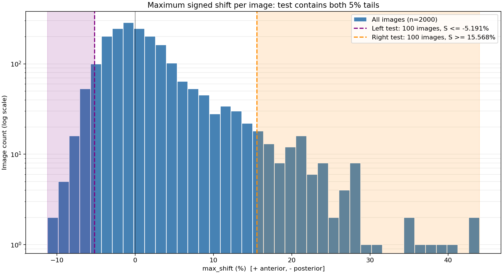
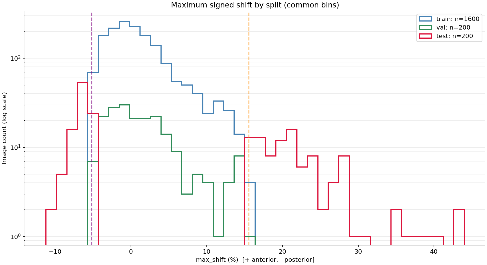

# Разбиение BUU по двум краям распределения max_shift

Создано 15 ноября 2026 года. Новая выборка:
`data/LumbarCoco2000MaxShiftTails/`. Исходное случайное разбиение
`data/LumbarCoco2000/` сохранено.

## Правило отбора

Каждый из 2000 снимков представлен одним числом `max_shift` — алгебраическим
максимумом пяти знаковых смещений соседних позвонков. Снимки сортируются
по `(max_shift, image_id, image_name)`:

1. Позиции 1–100: нижние 5% снимков → `test`.
2. Позиции 1901–2000: верхние 5% снимков → `test`.
3. Позиции 101–1900: средние 90%, перемешанные `random.Random(42)` →
   первые 1600 в `train`, следующие 200 в `val` (соотношение 8:1).

Всего: **1600 train / 200 val / 200 test**. В test две непересекающиеся
группы по 100 снимков. На границах при одинаковых значениях используется ID,
что сохраняет точный размер и воспроизводимость отбора.

Расчёт идёт по исходным аннотациям с переиспользованием геометрии
анализатора. Выборка отбирается по `max_shift`; минимум пяти пар
в отборе не используется. Для снимка из левого хвоста все пять значений
не больше его отрицательного максимума.

## Границы

| Группа | Условие по фактически выбранным значениям | Снимков |
| --- | --- | ---: |
| Левый край → test | `max_shift ≤ -0.051907451149` (-5.1907%) | 100 |
| Центр → train/val | от -5.1641% до 15.3822% | 1800 |
| Правый край → test | `max_shift ≥ 0.155683841633` (15.5684%) | 100 |

Для справки, интерполированные P5 и P95 равны
-0.051654006804 и 0.153915054561.
В разбиении используются ранги для получения ровно 100 снимков в каждом
хвосте, поэтому фактические крайние выбранные значения немного отличаются
от интерполированных процентилей. В JSON сохранены обе величины.

## График максимального смещения с логарифмической Y



По X — `max_shift` в процентах, линейная шкала. По Y — число снимков
в интервале, логарифмическая шкала. Каждый снимок учитывается один раз.
Фиолетовая область и линия обозначают левый test-хвост, оранжевая — правый.
Логарифмическая шкала делает редкие значения в хвостах видимее и не меняет
значения метрики, порядок снимков или размер выделенных групп.
Пустые интервалы на логарифмической Y не видны.

## Распределения нового train/val/test



Использованы общие 40 равномерных интервалов и логарифмическая Y.
Показаны абсолютные количества; размеры train, val и test различаются.
Граница отбора может проходить внутри гистограммного интервала, поэтому
соседние split могут иметь ненулевую частоту в одном и том же столбце.
Списки снимков при этом не пересекаются.

| Split | Снимков | Минимум max_shift | Максимум max_shift | Среднее | Медиана |
| --- | ---: | ---: | ---: | ---: | ---: |
| train | 1600 | -5.1641% | 15.3822% | 1.1999% | 0.3172% |
| val | 200 | -5.0527% | 15.3467% | 1.7154% | 0.5719% |
| test | 200 | -11.2090% | 43.9911% | 7.9087% | 5.1888% |

Этот test содержит крайние значения `max_shift`, а train/val — середину
его распределения. Оценка на таком test характеризует работу на выбранных
краях распределения.

## Файлы

- [COCO train](../../../data/LumbarCoco2000MaxShiftTails/annotations/lumbar_keypoints_train.json).
- [COCO val](../../../data/LumbarCoco2000MaxShiftTails/annotations/lumbar_keypoints_val.json).
- [COCO test](../../../data/LumbarCoco2000MaxShiftTails/annotations/lumbar_keypoints_test.json).
- [Манифест всех 2000 снимков: ранг, max_shift, split и причина отбора](split_manifest.csv).
- [Статистика, seed, границы и SHA-256 источников и выходных COCO](split_statistics.json).
- [Результаты независимой проверки](verification.json).
- [Скрипт создания разбиения](../../../tools/split_buu_by_max_shift.py).
- [Конфиг RTMPose-m для нового разбиения](../../../configs/rtmpose-m_lumbar-coco2000_max-shift-tails.py).

`images` нового датасета — ссылка на исходную папку LA.
Оригинальные изображения и поля COCO-записей, включая IDs, keypoints,
bbox, segmentation и категории, сохранены; в `info` добавлено описание split.

## Воспроизведение

Первый запуск с настройками по умолчанию:

```bash
MPLCONFIGDIR=/tmp/cv-matplotlib conda run --no-capture-output -n mmpose \
  python tools/split_buu_by_max_shift.py
```

Если разбиение уже существует, скрипт откажется перезаписывать артефакты.
Для независимого повторного запуска укажите новые директории:

```bash
MPLCONFIGDIR=/tmp/cv-matplotlib conda run --no-capture-output -n mmpose \
  python tools/split_buu_by_max_shift.py \
  --output /tmp/LumbarCoco2000MaxShiftTails-repeat \
  --report-dir /tmp/buu-max-shift-tails-repeat \
  --seed 42
```

Дополнительные параметры: `--annotations` (JSON или директории),
`--images-dir`, `--bins` (по умолчанию 40). Для точных 5% число снимков
должно делиться на 20. Невалидные измерения останавливают разбиение с ошибкой.

Отдельный конфиг наследует базовую модель и pipeline BUU-2000 и задаёт новые
пути во всех dataloader и COCO evaluator. Пример обучения из корня проекта:

```bash
conda run --no-capture-output -n mmpose python tools/train.py \
  configs/rtmpose-m_lumbar-coco2000_max-shift-tails.py \
  --work-dir work_dirs/rtmpose-m-lumbar-coco2000-max-shift-tails --amp
```

Обучение в рамках создания разбиения не запускалось.

## Проверки

Шесть тестов нового скрипта прошли: точные хвосты и размеры, отсутствие
пересечений, воспроизводимость seed, обработка совпадающих значений,
отказ при некорректных данных, сохранение COCO и запрет перезаписи.
CLI проверен на отдельном синтетическом наборе из 20 изображений.

```bash
MPLCONFIGDIR=/tmp/cv-matplotlib conda run --no-capture-output -n mmpose \
  python -m unittest discover -s tests -p test_split_buu_by_max_shift.py -v
```

На полном BUU-2000 независимо проверены все 2000 изображений и аннотаций,
совпадение scores с исходным CSV, точный состав двух хвостов, разбиение
середины с seed=42, отсутствие потерь/дубликатов/пересечений, доступность
всех путей к изображениям и сохранность SHA-256 исходных аннотаций.
Новый конфиг успешно прочитан через `mmengine.Config`; пути всех трёх
наборов и COCO evaluator указывают на новое разбиение.
